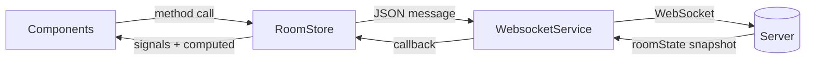

# Poker Planning — Web Client

The Angular client for [Poker Planning](https://github.com/ProgrammatoreInCamicia/PokerPlanning),
a self-hosted planning poker tool for agile estimation sessions. Built on **Angular 22
running zoneless**, with application state held entirely in signals — no NgRx, no RxJS
store, no `zone.js`.

- **Live instance:** <https://poker.programmatoreincamicia.dev>
- **Server:** [PokerPlanning](https://github.com/ProgrammatoreInCamicia/PokerPlanning) — ASP.NET Core 9, raw WebSockets
- **License:** [PolyForm Noncommercial 1.0.0](LICENSE.md) — free for noncommercial use, commercial use requires a separate license

---

## What it does

Create a room, share the link, everyone picks a card, the facilitator reveals them all at
once. Fibonacci or T-shirt deck, a backlog you can type in or import from CSV, vote
statistics with consensus and spread detection, a shared break timer, light/dark theming,
and the ability to throw an emoji at whoever estimated 21.

The server owns every piece of shared truth. This client renders it and sends intent —
that division is the whole architecture.

---

## Architecture

```
src/app/
├─ core/                     Cross-cutting services, no UI
│  ├─ websocket/             Socket lifecycle, reconnection, message contracts
│  ├─ http/                  REST calls: create room, CSV import/export
│  ├─ session/               Per-room identity in sessionStorage
│  ├─ theme/                 Light/dark/system preference
│  ├─ settings/              Sound and blink effect toggles
│  ├─ toast/, audio/, emoji/, utils/
├─ state/
│  └─ room.store.ts          The single source of truth for the session
├─ features/
│  ├─ join/                  Landing page: name, create room
│  └─ room/                  The session screen and its four panels
└─ shared/                   Presentational components: modal, overlays, icons, badges
```

Data flows in exactly one direction:



A component never talks to the socket and never mutates state. It calls a method on
`RoomStore` and reads signals back. `RoomStore` is the only consumer of `WebsocketService`
and the only writer of application state.

---

## Design decisions

### Zoneless, with signals as the only state primitive

The app runs on `provideZonelessChangeDetection()`. There is no `zone.js` in the bundle
and no monkey-patching of browser APIs; change detection runs because a signal read by a
template changed, and for no other reason.

That constraint is what makes the WebSocket layer simple. Messages arrive from outside
Angular's execution context — historically a classic source of "the UI didn't update"
bugs, solved with `NgZone.run()` wrappers scattered through socket handlers. With signals,
`this._participants.set(msg.participants)` inside a raw `onmessage` callback is enough:
the signal is the notification mechanism, so there is nothing to re-enter.

### A plain service instead of a state management library

`RoomStore` is a ~300-line `@Service()` holding a dozen private `signal()`s exposed as
readonly, plus `computed()` derivations. There is no NgRx, no reducer, no action type.

The reason is that the server already *is* the reducer. Actions go out as WebSocket
messages, the server validates and applies them, and the response is a complete state
snapshot — so the client's entire "reduce" step is `set()` on a handful of signals.
Layering a second state machine on top would duplicate the server's logic and create the
one bug worth avoiding: local state that disagrees with the room.

What is genuinely computed lives in `computed()`: vote distribution, average and median,
consensus and wide-spread detection, the participant-to-vote map. These are pure
derivations of server state and never stored.

### Optimistic selection, server-corrected

There is one exception to "the server owns the truth": the selected card highlights
immediately on click, before the server round-trip, because a 100 ms delay on your own tap
feels broken.

The correction is in the `roomState` handler — if the server says you have not voted, the
local selection was stale and is cleared:

```ts
if (me && !me.hasVoted) {
  this._selectedVote.set(null);
}
```

The same block re-syncs your role and display name from the server, so being promoted to
facilitator by someone else updates your UI on the next snapshot with no special message.

### Reconnection is the client's job

`WebsocketService` reconnects with exponential backoff capped at 15 seconds — 1s, 2s, 4s,
8s, 15s — and distinguishes a deliberate `disconnect()` from a dropped connection, so
being kicked stops the loop instead of hammering the server.

The important part is what happens *after* a successful reconnect: the service fires an
`onReconnected` callback, `RoomStore` re-sends the original `join`, and the server
recognises the `userId` and restores the seat, vote and role. Because every server message
is a full snapshot, no state reconciliation is needed — the first `roomState` after
reconnect is simply correct.

Connection state is exposed as a signal and surfaced in the UI as a badge, so a
participant can tell "nobody has voted yet" apart from "I am not connected".

### Identity in sessionStorage, keyed per room

A user is a `crypto.randomUUID()` generated at join time and stored under
`poker-session:{roomId}`. Session storage rather than local storage is deliberate: it
survives a refresh, which is the case that matters, but a new tab is a new participant —
which is what you want when someone opens a second room, and what makes testing with two
tabs possible without a private window.

### Standalone components, no NgModules

Every component is standalone with explicit `imports`. Two routes, no lazy loading — at
this size a route-level split would add a network round trip to save a few kilobytes.

---

## Running it

Requires Node 20+ and a running [backend](https://github.com/ProgrammatoreInCamicia/PokerPlanning).

```bash
npm install
npm start
```

The app serves at `http://localhost:4200` and expects the API at `https://localhost:7188`,
which is the default the .NET project listens on. Change `src/environments/environment.ts`
if yours differs.

```bash
npm run build      # production bundle into dist/
npm test           # unit tests via Vitest
```

### Environments

| File | `apiUrl` / `wsUrl` |
|---|---|
| `environment.ts` | `https://localhost:7188` — local development |
| `environment.prod.ts` | `https://poker-api.programmatoreincamicia.dev` — production |

Both URLs must point at the same host: the WebSocket connects to `{wsUrl}/poker/{roomId}`
and the REST calls to `{apiUrl}/rooms`.

---

## Known limitations

- **Test coverage is thin.** Most `.spec.ts` files are still the CLI-generated "should
  create" smoke tests. `RoomStore`'s `voteStats` computation and the `roomState` reducer
  are pure functions and the obvious place to start.
- **One message consumer.** `WebsocketService.onMessage` accepts a single callback rather
  than exposing a stream, since `RoomStore` is the only subscriber. A second consumer
  would need a `Subject`.
- **No offline queueing.** Messages sent while disconnected are dropped with a console
  warning rather than buffered for replay.
- **No i18n.** UI copy and server error messages are Italian.

---

## License

[PolyForm Noncommercial License 1.0.0](LICENSE.md).

Free to read, run, modify, and share for any **noncommercial** purpose — personal use,
study, hobby projects, and use by nonprofits, schools, and public institutions. **Using it
inside a for-profit company, or offering it as a service, requires a commercial license.**
Get in touch if that's you.
